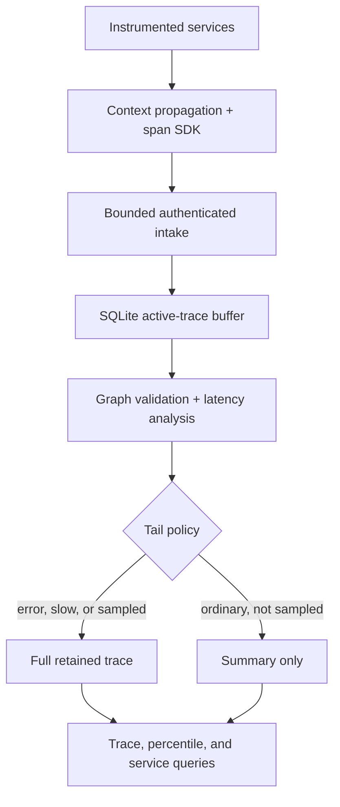

# TraceLens

TraceLens is a local distributed-tracing collector that propagates W3C-style trace context, accepts out-of-order spans idempotently, reconstructs and validates trace trees, attributes latency to services, and makes a deterministic tail-sampling decision after a trace is complete. It is an **independent educational implementation inspired by documented Google tracing challenges**—not Google software and not a claim of work performed for Google.

The core uses only the Python standard library. The demo is synthetic and runs locally without credentials, paid services, or network access.

## The documented company problem

A user request in a service-oriented system can cross many processes and machines. Per-service logs and averages do not reconstruct that request's causal path, while retaining every detailed trace can create material ingestion and storage cost. The engineering tension is to preserve diagnostically valuable slow and failed traces without recording every ordinary request.

### What Google documents (facts)

| Primary source | Documented fact used as context |
| --- | --- |
| [Google Research: *Dapper, a Large-Scale Distributed Systems Tracing Infrastructure* (2010)](https://research.google/pubs/dapper-a-large-scale-distributed-systems-tracing-infrastructure/) | Google describes production systems spread across services and machines, making behavior and performance difficult to understand. Dapper was designed for low overhead, application-level transparency, and ubiquitous deployment, and it uses sampling to control tracing cost. |
| [Google Cloud Trace: *Trace sampling*](https://docs.cloud.google.com/trace/docs/trace-sampling) | Google distinguishes head sampling, decided when a trace starts, from tail sampling, decided after the complete trace is available. Tail sampling requires spans for the same trace to reach the same collector and temporarily consumes storage before the decision. Sampling helps manage observability cost and ingestion quotas. |
| [Google Cloud Trace: *Trace context*](https://docs.cloud.google.com/trace/docs/trace-context) | Google documents trace IDs, span IDs, parent span IDs, and propagation via the W3C `traceparent` header so spans from one request can be assembled into a trace. |
| [Google SRE Book: *Monitoring Distributed Systems*](https://sre.google/sre-book/monitoring-distributed-systems/) | Google explains that averages can hide long-tail behavior, while percentile distributions reveal outliers; retaining high-cardinality raw detail indefinitely can be expensive. |

### What this project infers and designs independently

The sources establish the distributed-diagnosis and sampling problem; they do not prescribe this implementation. TraceLens independently chooses a single-node SQLite buffer, a strict JSON schema, deterministic hash sampling for ordinary traces, always-keep policies for errors and slow traces, an interval-sweep latency attribution algorithm, a bounded HTTP API, and a tiny Python context-manager SDK.

The comparison with 10% head sampling is a deterministic local experiment, not a measurement of Google infrastructure. Google Cloud Trace's documentation also notes that Cloud Trace itself does not directly perform tail sampling; TraceLens is a learning implementation of the intermediary-collector pattern described there.

## Why the problem matters

- A rare failed checkout can disappear under random head sampling, leaving only healthy traces when an incident is investigated.
- Keeping all spans provides detail but increases storage, indexing, and operator-query cost as traffic grows.
- Trace data is only trustworthy if duplicate delivery is idempotent, conflicting reuse is rejected, and malformed causal graphs fail closed.
- Service-level latency attribution turns a slow request from “the API took 112 ms” into an actionable candidate such as “inventory dominated the critical timeline.”

## Architecture



| Component | Responsibility |
| --- | --- |
| Span model | Validates canonical nonzero IDs, safe bounded names, timestamps, enum fields, typed attributes, and strict schema shape. |
| SDK | Creates nested spans with monotonic durations, propagates `traceparent`, records exception type without suppressing application errors, and exports completed spans. |
| Intake | Accepts out-of-order batches, treats byte-equivalent redelivery as idempotent, rejects a reused span ID with changed content, and rolls back an entire conflicting batch. |
| Active buffer | Stores incomplete traces in SQLite WAL mode with active-trace, span-per-trace, batch, request-body, and worker bounds. |
| Analyzer | Requires one rooted acyclic tree, tolerates at most 5 ms configured clock skew, unions overlapping child intervals, derives service edges, and assigns each segment of root wall time to the deepest active span. |
| Tail policy | Keeps every trace with an error, then every trace above the latency threshold, then a stable hash-selected fraction of ordinary traces. It deletes full spans for an unselected trace but retains its aggregate summary. |
| Query layer | Returns a retained trace, sampling reasons, exact nearest-rank p50/p95/p99 latency, bottleneck counts, and a retained-trace service graph. |

## Reproduce it

Requirements: Python 3.11+; no third-party packages.

```bash
git clone https://github.com/psatyasaiganesh-oss/TraceLens.git
cd TraceLens
python -m compileall -q tracelens tests
python -m unittest discover -v
python -m tracelens demo
```

The deterministic demo submits 800 shuffled six-span checkout traces across six services. It injects 50 slow inventory paths and 20 payment failures (10 traces contain both), redelivers 80 spans, attempts one conflicting duplicate, and validates five malformed payloads. It compares the tail policy with a stable 10% head decision over the same trace IDs.

Checked-in [demo output](reports/demo.json) and [validation evidence](reports/validation.json) were produced from this code. Wall-clock duration varies; the content metrics are deterministic.

| Result | Measured value |
| --- | ---: |
| Automated tests | 68 passed |
| Synthetic workload | 800 traces / 4,800 spans |
| Injected anomalies | 60 unique traces (50 slow, 20 error, 10 overlap) |
| Anomalies retained by tail policy | 60/60 (100%) |
| Anomalies selected by deterministic 10% head baseline | 8/60 (13.33%) |
| Slow-trace bottleneck attribution | 50/50 identified `inventory` (100%) |
| Duplicate/conflict checks | 80/80 redeliveries idempotent; 1/1 conflicting reuse rejected |
| Invalid payload checks | 5/5 rejected |
| Full traces retained | 136/800 |
| Span rows retained | 816/4,800; 83.0% reduction after decisions |
| Root latency | p50 32 ms; p95 112 ms; p99 112 ms |

These are local synthetic validation results, not production performance numbers or Google results. “83.0% reduction” counts span rows after finalization; TraceLens still keeps one summary row per dropped trace, and tail sampling temporarily buffers every span.

### Docker

```bash
docker build -t tracelens .
docker run --rm tracelens demo
```

The image compiles the package and runs the full test suite during build, then runs the CLI as an unprivileged user. The GitHub workflow tests Python 3.11–3.13 and separately builds and executes the container.

## CLI walkthrough

All commands return JSON. The included trace fixture makes the basic path reproducible:

```bash
python -m tracelens init /tmp/tracelens.sqlite3
python -m tracelens ingest /tmp/tracelens.sqlite3 examples/trace.json
python -m tracelens finalize /tmp/tracelens.sqlite3 \
  11111111111111111111111111111111 --normal-sample-rate 1
python -m tracelens show /tmp/tracelens.sqlite3 \
  11111111111111111111111111111111
python -m tracelens overview /tmp/tracelens.sqlite3
python -m tracelens services /tmp/tracelens.sqlite3
```

Expected input and state failures are emitted as structured JSON on stderr with exit status 2.

## Collector API

Loopback is the safe default:

```bash
python -m tracelens serve /tmp/tracelens.sqlite3 --port 8080
curl http://127.0.0.1:8080/health
curl -H 'Content-Type: application/json' \
  --data @examples/trace.json http://127.0.0.1:8080/v1/spans
curl -H 'Content-Type: application/json' \
  --data '{"normal_sample_rate":1}' \
  http://127.0.0.1:8080/v1/traces/11111111111111111111111111111111/finalize
```

A non-loopback bind fails unless a bearer token is supplied through an environment variable:

```bash
export TRACELENS_TOKEN='replace-with-at-least-16-characters'
python -m tracelens serve /tmp/tracelens.sqlite3 \
  --host 0.0.0.0 --token-env TRACELENS_TOKEN
```

The token is compared in constant time. The server rejects transfer encoding, missing or nondecimal content lengths, non-JSON media types, oversized bodies, unknown request fields, invalid thresholds, and unauthenticated data access. `/health` intentionally remains public.

## SDK example

```python
from tracelens.sdk import StoreExporter, Tracer
from tracelens.store import TraceStore

store = TraceStore("traces.sqlite3")
tracer = Tracer("checkout", StoreExporter(store))

with tracer.span("POST /checkout", kind="SERVER") as request:
    downstream_header = request.traceparent()
    with tracer.span("reserve-stock", kind="CLIENT") as child:
        child.set_attribute("inventory.region", "local-test")
```

In a different process, pass `incoming=downstream_header` to continue the same trace. The application must explicitly finalize a trace only after all spans are expected; premature finalization intentionally rejects later arrivals.

## Correctness and security choices

- Intake hashes canonical span JSON. Identical retries are no-ops; a different payload under the same `(trace_id, span_id)` is a conflict, and batch transactions are all-or-nothing.
- Finalization validates one root, unique IDs, parent existence, acyclicity, containment within parent/root bounds, and clock skew before any sampling state changes.
- Ordinary sampling uses SHA-256 of the trace ID, so retries and process restarts cannot change a decision. Errors take precedence over slow status, which takes precedence over probabilistic retention.
- SQLite uses `BEGIN IMMEDIATE`, foreign keys, full synchronous durability, WAL journaling, a schema version, and an owner-only database mode.
- The HTTP listener is loopback-first, bounds body size and concurrent workers, requires authentication when exposed, uses no-store/nosniff headers, and returns generic text for unexpected exceptions.
- Attribute count, encoded size, keys, values, service/name fields, batch size, active traces, and spans per trace are bounded to constrain accidental resource abuse.
- SDK durations use a monotonic clock even though wall-clock nanoseconds are recorded for cross-service ordering. An exporter error never replaces an exception already raised by application code.

## Design tradeoffs

| Decision | Benefit | Cost / alternative |
| --- | --- | --- |
| Decide after explicit finalization | Complete information enables error/latency-aware retention | A missing finalization leaves buffered data; production collectors use idle deadlines, watermarks, and late-span policy. |
| Full span buffer in SQLite | Durable, inspectable, dependency-free local demo | Tail sampling temporarily pays full ingestion/storage cost; a fleet needs trace-ID routing and distributed capacity control. |
| Exact percentiles from summaries | Transparent and correct for this bounded lab | Loads all finalized durations; production systems use mergeable sketches or histograms. |
| Deepest-active-span attribution | Handles concurrency without double-counting root wall time | It is a heuristic, not causal proof; asynchronous links and queue time need richer semantics. |
| Delete unselected span rows | Demonstrates concrete detail-storage reduction | Prevents later policy changes or deep debugging of dropped traces; tiered storage could preserve cheap archives. |
| Minimal custom SDK/schema | Makes propagation and invariants easy to inspect | It is not OTLP/OpenTelemetry compatible; a production version should adopt standard exporters and semantic conventions. |

## Known limits

- TraceLens is a single-node educational collector, not a Google service, production tracing backend, or benchmark of one.
- It has no OTLP receiver, TLS termination, multi-tenant authorization, encryption at rest, rate limiting by tenant, distributed routing, replication, retention scheduler, background compaction, or high-availability failover.
- The bearer token is application-level protection; terminate TLS in front of any remote deployment and use a real secret manager. A privileged host user can read or modify local state.
- Completeness is asserted by the caller's `finalize` request. There are no expected-span counts, idle timeouts, late-span reconciliation, or cross-collector coordination.
- Only parent/child trees are supported. Span links, baggage, events, exemplars, resource records, and W3C trace flags other than sampled/not-sampled are outside scope.
- A 5 ms clock-skew tolerance is a configurable validation heuristic. It does not synchronize clocks or correct arbitrary skew.
- The service graph represents only retained full traces by default, so probabilistic policy can bias topology counts.
- Tail sampling reduced retained span rows by 83.0% in the synthetic workload, but it did not reduce ingress bandwidth or peak pre-decision buffering.

## Interview material

Use [the focused interview walkthrough](docs/INTERVIEW.md) for a 6-minute narrative, code tour, failure scenarios, expected questions, and evidence-based resume bullets.

## Project layout

```text
tracelens/
  model.py        strict span and trace-context validation
  sdk.py          nested instrumentation and propagation
  store.py        transactional intake, tail policy, and queries
  analysis.py     graph invariants and latency attribution
  httpserver.py   bounded authenticated JSON collector
  demo.py         deterministic six-service fault experiment
  __main__.py     JSON CLI
tests/            68 unit and integration tests
examples/         a reproducible two-span trace
reports/          captured demo and validation evidence
Dockerfile        tested, non-root runtime image
```
